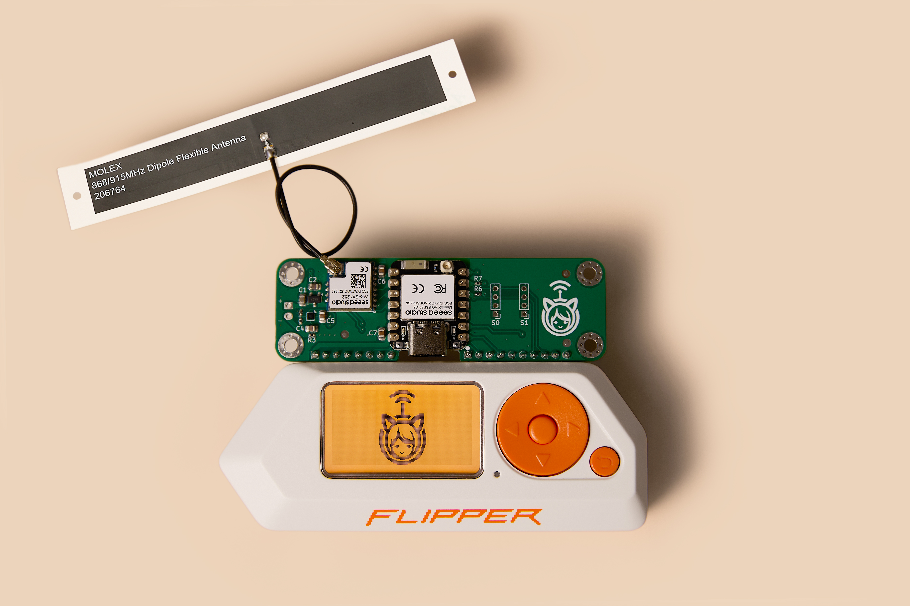

<h1>Meshimi</h1>

<b>Módulo Inalámbrico Multi-Protocolo de Hardware Abierto y Código Fuente Abierto</b>

Meshimi potencia tu Flipper Zero con capacidades avanzadas de redes mesh, utilizando los protocolos Meshtastic, LoRaWAN, WiFi6 y Bluetooth.

## 📁 Estructura del Repositorio
- [`hardware/`](hardware) - Esquemáticos de PCB, diseños y archivos de producción
- [`mechanical/`](mechanical) - Modelos 3D, carcasas y guías de ensamblaje
- [`firmware/`](firmware) - Firmware principal y ejemplos de código
- [`software/`](software) - Aplicación para Flipper Zero y herramientas de configuración
- [`documentation/`](documentation) - Documentación, guías y certificaciones
- [`assets/`](assets) - Logotipos, fotos y materiales de marketing

## 📖 Documentación

### 🛡️ Certificaciones
El proyecto Meshimi utiliza módulos de RF precertificados para garantizar el cumplimiento normativo. 
La documentación de certificación correspondiente (CE, FCC y otras) para estos módulos está disponible 
en el directorio [certificaciones](documentation/certifications). 

Nos comprometemos a mantener el cumplimiento total de la normativa.

_En Meshimi se utiliza el módulo Seeed XIAO ESP32-C6_, el cual cuenta con las siguientes certificaciones:

1. [Seeed-XIAO-ESP32C6-CE-Verification.pdf](documentation/certifications/Seeed-XIAO-ESP32C6-CE-Verification.pdf)

2. [Seeed-XIAO-ESP32C6-EU-Declaration.pdf](documentation/certifications/Seeed-XIAO-ESP32C6-EU-Declaration.pdf)

3. [Seeed-XIAO-ESP32C6-FCC-Declaration.pdf](documentation/certifications/Seeed-XIAO-ESP32C6-FCC-Declaration.pdf)

4. [Seeed-XIAO-ESP32C6-TELEC-Certificate.pdf](documentation/certifications/Seeed-XIAO-ESP32C6-TELEC-Certificate.pdf)

5. [Seeed-XIAO-ESP32C6-UK-Declaration.pdf](documentation/certifications/Seeed-XIAO-ESP32C6-UK-Declaration.pdf)

6. [Seeed-XIAO-Series-RoHS-Certificate.pdf](documentation/certifications/Seeed-XIAO-Series-RoHS-Certificate.pdf)

_En Meshimi se utiliza el módulo Seeed Wio SX-1262_, el cual cuenta con las siguientes certificaciones:

1. [Seeed-Wio-SX1262-CE-Verification.pdf](documentation/certifications/Seeed-Wio-SX1262-CE-Verification.pdf)

2. [Seeed-Wio-SX1262-EU-Declaration.pdf](documentation/certifications/Seeed-Wio-SX1262-EU-Declaration.pdf)

3. [Seeed-Wio-SX1262-FCC-Authorization.pdf](documentation/certifications/Seeed-Wio-SX1262-FCC-Authorization.pdf)

4. [Seeed-Wio-SX1262-TELEC-Certificate.pdf](documentation/certifications/Seeed-Wio-SX1262-TELEC-Certificate.pdf)

5. [Seeed-Wio-SX1262-UK-Declaration.pdf](documentation/certifications/Seeed-Wio-SX1262-UK-Declaration.pdf)

6. [Seeed-Wio-SX1262-RoHS-Certificate.pdf](documentation/certifications/Seeed-Wio-SX1262-RoHS-Certificate.pdf)
